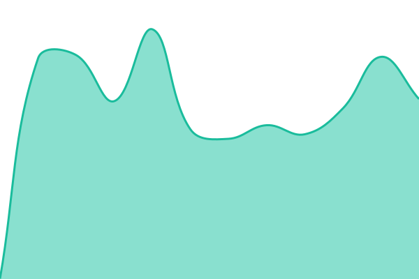
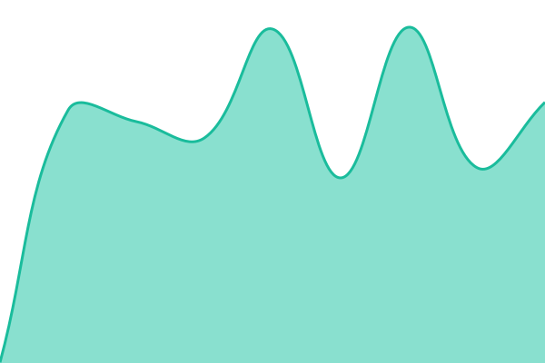

This repository contains the open-source uptime monitor and status page for [Predivo-GmbH](https://status.predivo.ch), powered by [Upptime](https://github.com/upptime/upptime).

## [📈 Live Status](https://status.predivo.ch): <!--live status--> **Alle Systeme laufen normal**

<!--start: status pages-->
<!-- This summary is generated by Upptime (https://github.com/upptime/upptime) -->
<!-- Do not edit this manually, your changes will be overwritten -->
<!-- prettier-ignore -->
| URL | Status | History | Response Time | Uptime |
| --- | ------ | ------- | ------------- | ------ |
|  [Website](https://predivo.ch/de) | In Betrieb | [website.yml](https://github.com/Predivo-GmbH/status-predivo/commits/HEAD/history/website.yml) | 

 1377ms
     
 | 

<a href="https://Predivo-GmbH.github.io/status-predivo/history/website">99.37%</a>
    

|  [Client portal](https://portal.predivo.ch) | In Betrieb | [client-portal.yml](https://github.com/Predivo-GmbH/status-predivo/commits/HEAD/history/client-portal.yml) | 

 521ms
     
 | 

<a href="https://Predivo-GmbH.github.io/status-predivo/history/client-portal">99.56%</a>
    

|  [Contact form](https://predivo.ch/api/contact.php) | In Betrieb | [contact-form.yml](https://github.com/Predivo-GmbH/status-predivo/commits/HEAD/history/contact-form.yml) | 

 478ms
     
 | 

<a href="https://Predivo-GmbH.github.io/status-predivo/history/contact-form">99.77%</a>
    

|  [Client portal sign-in](https://xoecpzfsskalvjrtcbbl.supabase.co/auth/v1/health) | In Betrieb | [client-portal-signin.yml](https://github.com/Predivo-GmbH/status-predivo/commits/HEAD/history/client-portal-signin.yml) | 

 655ms
     
 | 

<a href="https://Predivo-GmbH.github.io/status-predivo/history/client-portal-signin">100.00%</a>
    

|  [Email](mail.predivo.ch) | In Betrieb | [email.yml](https://github.com/Predivo-GmbH/status-predivo/commits/HEAD/history/email.yml) | 

 135ms
     
 | 

<a href="https://Predivo-GmbH.github.io/status-predivo/history/email">99.94%</a>
    

<!--end: status pages-->
